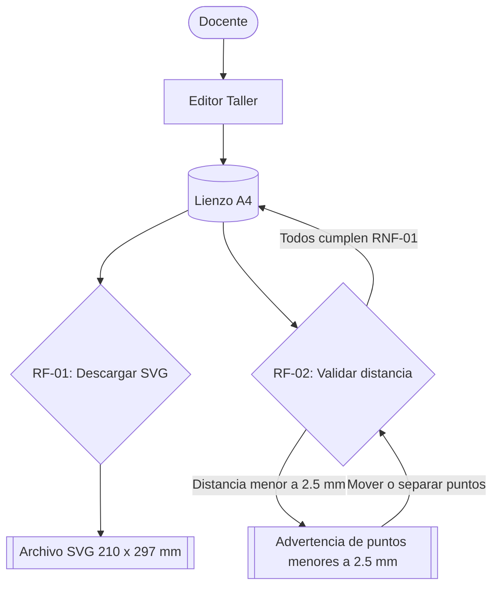

# Diagramas del proyecto (Mermaid)

## Caso de uso del Taller

Los docentes realizan dos acciones relacionadas dentro del Taller: exportar la lámina y validar la separación entre puntos.

## Trazabilidad

- [RF-01](../requisitos/funcionales.md) y [RNF-02](../requisitos/no-funcionales.md) corresponden a la historia [#6](https://github.com/josephsegura-prog/Pograma_para_galenano/issues/6).
- [RF-02](../requisitos/funcionales.md), [RNF-01](../requisitos/no-funcionales.md) y [RNF-03](../requisitos/no-funcionales.md) corresponden a la historia [#7](https://github.com/josephsegura-prog/Pograma_para_galenano/issues/7).
